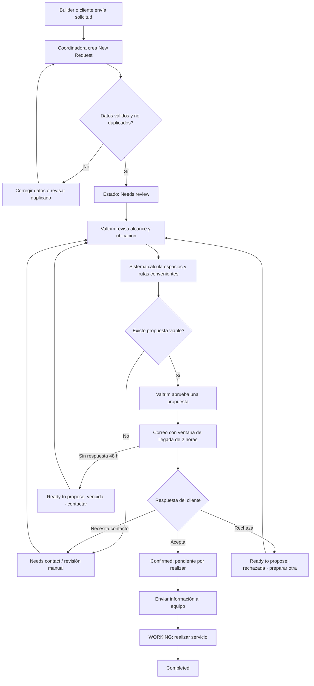

# Customer Service: solicitudes y programación de servicios

> **Reglas vigentes:** consultar [Customer Service — reglas del proyecto](customer-service-business-rules.md).
> Esta especificación conserva secciones históricas de distintas etapas. Cuando
> una regla sea incompatible, prevalece la decisión vigente de ese documento;
> los pendientes allí identificados no se consideran implementados.

## Estado del documento

- **Propósito:** definir el alcance funcional y técnico del módulo Customer Service.
- **Bandeja de correos, bloque 2 preparado localmente el 2 de noviembre de 2026:**
  bandeja única con tres estados, motivo y acción por mensaje; reintento y vínculo
  confirmado consultan su resultado guardado y actualizan contadores/folio.
  Selector con comparación humana, acceso a solicitudes y recuperación vigente.
  Conexión técnica separada, cabeceras seguras y lectura individual autenticada.
  Sin imágenes almacenadas ni cambios en la aprobación; no se confirmaron los
  dos vínculos reales. Nueva migración, reconcile y frontend pendientes de
  publicación. Ver [contrato y validación](customer-service-email-inbox-block-2.md).
- **Bandeja de correos, bloque 1 preparado localmente el 2 de noviembre de 2026:**
  estados operativos PROCESSING/REQUIRES_ACTION/REGISTERED, lectura resumida y
  confirmación humana de que un correo sin importación corresponde a una request
  existente. Vínculos privados, permisos, versión y auditoría; exclusión exacta
  en sync y reapertura si el destino se elimina. Sin nuevas requests, aprobación,
  archivos o reseteo del cursor por la vinculación. Migración y despliegue sync
  a cargo del usuario; UI y casos reales pendientes del bloque 2. Ver
  [contrato, validación y comandos](customer-service-email-inbox-block-1.md).
- **Nombre del propietario, bloque 2 preparado localmente el 2 de noviembre de
  2026:** reintento selectivo del texto histórico con HOMEOWNER sin nombre cuando
  el informe previo señala ese problema. Versión opcional del análisis EMAIL
  evita repetir la corrección en continuaciones; conserva imágenes/PDF válidos
  y la misma importación. Sin aprobación automática ni reencolado masivo. Nueva
  migración compatible, worker/retry y recuperación real pendientes de desplegar
  y ejecutar por el usuario. Pasaron 171 pruebas Deno y tres suites SQL remotas
  con rollback. Ver [alcance y comandos](customer-service-homeowner-name-block-2.md).
- **Nombre del propietario, bloque 1 preparado localmente el 2 de noviembre de
  2026:** instrucciones y esquema distinguen nombre personal y etiqueta del
  campo. La extracción nueva de texto rechaza etiquetas genéricas como nombres,
  comprueba nombres explícitos en el correo y conserva roles/datos incompletos
  para revisión. Los valores PDF separados conservan su tratamiento. No hay
  migración ni recuperación del piloto en este bloque; el reintento selectivo y
  despliegue conjunto corresponden al bloque 2. Ver
  [validación y límites](customer-service-homeowner-name-block-1.md).
- **Automatización aprobada y preparada localmente el 30 de octubre de 2026:**
  consulta delta cada minuto, worker condicionado a pendientes/reintentos/
  continuaciones y comprobación de metadatos cada 15 minutos. Firmas temporales
  de un solo uso, exclusión de llamadas superpuestas, errores y pausa visibles,
  resumen ligero para actualizar Requests sin reemplazar ediciones abiertas.
  Los correos omitidos se señalan y enlazan para revisión, sin reimportación
  histórica ni reset del cursor. Se mantienen imágenes en memoria y revisión
  humana. Migración nueva instalada en pausa; despliegue y activación quedan
  a cargo del usuario. No equivale a automatización activa. Ver
  [implementación, pruebas y comandos](customer-service-email-automation.md).
- **Planificación compartida, preparada localmente el 29 de octubre de 2026:**
  catálogo y cálculo únicos para importador, formulario y extracción PDF/texto.
  Proponer clasificación global, duración y crew desde tareas/ítems incluidos;
  conservar contradicciones y valores manuales. Completar faltantes al editar
  NEEDS_REVIEW con cambios pendientes de guardar, sin alterar View o estados
  bloqueados. Vacío no significa duración manual. Sin migración. Los despliegues
  del usuario se confirmaron: worker ACTIVE v15 y retry ACTIVE v11, con 21/21 y
  23/23 archivos coincidentes y arranque HTTP comprobado sin procesar correo.
  Publicación frontend no verificada. CS-1974 se comprobó
  en memoria con Doors/General fix/30/1, sin modificarla. Ver
  [validación y comandos](customer-service-planning-rules-2026-10-29.md).
- **Ampliación aprobada el 29 de octubre de 2026:** hasta tres customers por
  request, el primero como principal y dos adicionales, también en importación.
  El botón Add another customer permite añadir ambos. Lectura, edición y
  aprobación conservan y validan los tres, con orden estable. Los teléfonos de
  diez dígitos sin prefijo se normalizan a +1 cuando la dirección fuente tiene
  estado de Estados Unidos y ZIP válidos; se conserva el original y se advierte
  para revisión. Un teléfono aislado o ambiguo no define el país. Esta ampliación
  sustituye los límites de un solo adicional descritos en etapas anteriores.
  La migración nueva `20261029190000` está aplicada. CS-1974 ya tiene tres
  contactos con sus teléfonos, conservando fuente/análisis e identidad y
  NEEDS_REVIEW. El frontend está actualizado localmente, sin publicación.
  Ver [validación y alcance](customer-service-three-customers-2026-10-29.md).
- **Selección de propietario aprobada el 29 de octubre de 2026:** el primer
  HOMEOWNER en el orden del correo será el contacto principal, con el cuerpo
  antes de los adjuntos; remitente y representante del constructor no lo
  sustituyen. Varios propietarios no bloquean el alta: todos se conservan en la
  extracción con advertencia, sin ampliar el formulario de principal y adicional
  ni eliminar validaciones. Los checkpoints válidos permiten recalcular el alta
  sin nueva inferencia. La corrección y su aplicación al mismo piloto se detallan
  en [su resultado](customer-service-email-pilot-2026-10-29.md).
- **Corrección desplegada y piloto recuperado:** la misma importación creó
  **974 / CS-1974**, NEEDS_REVIEW, primer propietario principal y los tres en la
  extracción, sin duplicados, binarios ni archivos nuevos. Se corrigió también
  la comparación de offsets del checkpoint independiente del orden de claves
  jsonb: los cinco checkpoints reales se reutilizan en memoria sin proveedor o
  descargas. Pasaron 74 pruebas de análisis y 44 de worker, tipos/lint; worker
  ACTIVE v12, retry ACTIVE v8 y sync ACTIVE v9. Sin migración ni cron; revisión
  y aprobación humanas pendientes.
- **Resultado inicial del piloto V2 del 29 de octubre de 2026, antes de la corrección anterior:** una importación real, cuerpo y cuatro
  imágenes inline ANALYZED en memoria, cero archivos nuevos y sin duplicados en
  repetición de sync/worker. Quedó NEEDS_ATTENTION por tres propietarios sin
  principal inequívoco; no creó request ni consumió folio. La secuencia compartida
  de alta manual/correo sigue con CS-1974 como siguiente disponible. El caso
  estrictamente sin adjuntos y la resolución humana permanecen pendientes, sin
  activar cron. Ver [resultado](customer-service-email-pilot-2026-10-29.md).
- **Imágenes sin retención, bloque 4 implementado localmente el 28 de octubre de
  2026:** visor V1/V2 con lectura del manifiesto/análisis completo, selección por
  attachmentId, texto/hechos/advertencias por adjunto y enlace a Outlook. Las
  imágenes GRAPH_ONLY no solicitan archivos; los PDF y originales históricos
  mantienen acceso privado y muestran errores de archivos eliminados sin perder
  la extracción. Sin migraciones ni cambios de funciones; 453 pruebas frontend,
  lint/build y comprobación de escritorio/móvil con datos simulados. Pendientes
  publicación del frontend y piloto integral real. Ver
  [pruebas del bloque 4](customer-service-image-no-retention-block-4-testing.md).
- **Imágenes sin retención, bloque 3 preparado el 28 de octubre de 2026:** el
  worker reclama V1/V2, lee desde Graph solo las imágenes pendientes y conserva
  texto/hechos sin binarios ni archivos nuevos. Valida el manifiesto completo y
  el hash original, reutiliza análisis válidos y mantiene PDF/historial V1 en
  Storage. La migración nueva `20261028220000` permite esperas Retry-After
  durables sin reducir el backoff ni ampliar los tres fallos permitidos. El alta
  sigue siendo única en NEEDS_REVIEW y requiere aprobación humana independiente.
  Los tres bloques se confirmaron aplicados en BD en la revisión posterior del
  28 de octubre; sync ACTIVE v9, worker ACTIVE v10 y retry ACTIVE v6, con código
  contrastado y sin migraciones pendientes. El visor continúa pendiente para el
  bloque 4. Ver [confirmación](customer-service-image-deployment-verification-2026-10-28.md).
  Ver [alcance, pruebas y comandos](customer-service-image-no-retention-block-3-testing.md).
- **Imágenes sin retención, bloque 2 preparado el 28 de octubre de 2026:** el
  conector prepara fuentes nuevas V2 con imágenes solo en memoria y almacenamiento
  exclusivo de PDF, conservando límites, errores, idempotencia y originales V1.
  La migración nueva `20261028200000` restringe cargas nuevas a PDF y añade
  recuperación V2 explícita con versión/auditoría, sin convertir manifiestos
  anteriores ni modificar el cursor. Bloques 1 y 2 aplicados en BD; el despliegue
  de `customer-service-email-sync` no se comprobó al iniciar el bloque 3. Validados 86 casos del
  conector, 59 regresiones y trece suites SQL con ROLLBACK, más tipos/lint. No
  ejecuta IA, crea requests ni activa cron: worker V2 y visor siguen pendientes.
  Ver [contrato y comandos](customer-service-image-no-retention-block-2-testing.md).
- **Imágenes de correo sin retención, bloque 1 preparado el 28 de octubre de
  2026:** contrato SQL V2 con manifiesto completo, imágenes GRAPH_ONLY sin archivo,
  PDF STORED, origen Graph fijado, checkpoints/análisis por identidad y hash y
  lectura autenticada de extracción por fuente. V1 conserva el historial y el
  runtime actual; su claim no toma fuentes V2 pendientes. La migración nueva
  `20261028180000` se comprobó aplicada; quince suites SQL distintas pasaron
  en preview remoto con ROLLBACK. No se modifican frontend/Edge Functions ni se
  activa la política de runtime o cron. Los bloques siguientes deben adaptar
  conector, worker/reintentos y visor. Ver
  [contrato, pruebas y activación](customer-service-image-no-retention-block-1-testing.md).
- **Punto 5 — visor de originales autorizado el 27 de octubre de 2026:** ampliar
  el diálogo Source & extraction dentro de View/Edit Request. Presenta el correo
  retenido como texto inerte, cabeceras, fechas de California y enlace original
  disponible; lista archivos privados con `get_customer_service_import_source_files`
  y abre PDF/imágenes mediante `customer-service-import-source` con la sesión
  humana vigente. Carga el archivo seleccionado, renueva enlaces y permite
  reintentar errores; distingue fuentes rechazadas de correos sin adjuntos.
  Mantiene el PDF de recuperación y su extracción en pestañas separadas, sin
  reemplazar el correo ni la captura pendiente del formulario. Reutiliza backend
  y almacenamiento existentes; sin nueva migración ni cambio de workflow.
  Preparado en frontend; el piloto autenticado real sigue siendo una validación
  independiente de las pruebas locales. Validación: 445 pruebas frontend (nueve
  nuevas), lint completo y build aprobados; revisión Playwright con respuestas
  simuladas en escritorio/móvil, reintentos, expiración, respuestas atrasadas,
  formulario sin guardar y separación de fuentes de recuperación.
- **Punto 4 / bloque 7.4 — conector preparado el 27 de octubre de 2026:** endpoint
  de servidor con secreto propio, autenticación app-only, lectura delta por carpeta,
  IDs inmutables, cuerpos completos y adjuntos/inline validados con el contrato
  existente. Solo avanza páginas completamente retenidas o con problemas durables;
  las fuentes AVAILABLE quedan en la cola del worker existente, que se ejecuta
  aparte. Respeta BASELINE_ONLY, conserva Retry-After en BD y bloquea cursores
  vencidos sin reiniciarlos. Los IDs privados de la línea base se confirman junto
  con el cursor y evitan importar históricos por cambios de leído/no leído.
  No añade aprobación, cambios al buzón, cron ni UI.
  Migraciones `20261027190000` y correctiva `20261027200000` aplicadas; endpoint
  ACTIVE v4. Se admiten claves OData `mailFolders('ID')` y rutas `/mailFolders/ID`
  sin debilitar buzón/carpeta ni alterar URLs/tokens. Con controles habilitados,
  el reintento BASELINE_ONLY terminó con ROUND_COMPLETE/DELTA, error nulo y
  reserva liberada, conservando cero importaciones/requests. Queda probar una
  entrada posterior y su extracción/revisión; no se activó ejecución periódica.
  Ver [alcance, pruebas y activación](customer-service-email-import-block-7-4-testing.md).
- **Importación por correo, bloque 7.3 — configuración privada preparada el 23 de
  octubre de 2026:** tabla no expuesta en `private`, RPC exclusivos de sistema y
  adaptador TypeScript del backend. Registra tenant/buzón/carpeta sin credenciales,
  crea conexiones deshabilitadas y exige una decisión explícita sobre históricos
  antes de habilitar. Reserva temporal, token y revisión impiden avances tardíos;
  pausa/deshabilitación/fallo conservan el cursor. Los enlaces Graph completos se
  validan contra buzón/carpeta y cada página confirma sus importaciones durables.
  NEXT no es éxito completo; DELTA completa la ronda. No crea requests, consume
  IA ni añade OAuth callback, conector, cron o UI. El esquema ya está disponible
  en remoto. Para el piloto se confirmó `victor@valtriminc.com`, carpeta raíz
  `Customer Service` y `BASELINE_ONLY`, con conexión inicialmente deshabilitada.
  El usuario proporcionó el UUID correcto y se verificó mediante la carpeta por
  UUID y dirección. La conexión `779ebb10-fc40-4a30-9a72-639123cbb057` está guardada
  con revisión 1, cero intentos/importaciones y sin cursor/inicialización; su
  replay conservó identidad y revisión. El 27 de octubre pasaron las 11 pruebas del adaptador y
  la suite SQL remota; ver [contrato y pruebas del bloque 7.3](customer-service-email-import-block-7-3-testing.md).
- **Bloque 6 — cierre técnico verificado el 23 de octubre de 2026:** migración
  aplicada, reintento v1/PDF v6 ACTIVE con JWT y nueve suites SQL aprobadas.
  Las secciones históricas siguientes describen entregas que entonces estaban
  pendientes, no pendientes actuales. No se repitió el piloto visual con PDF real.
- **Importación por correo, bloque 6 — acciones preparadas el 23 de octubre de
  2026:** reintento con confirmación mediante `customer-service-email-retry`,
  JWT y rol activo, usando únicamente importId/versión. No se expone el secreto
  del worker. Se conservan reservas/checkpoints/esperas; una continuación manual
  permanece visible sin habilitar cron ni alterar el worker automático.
  Recuperación PDF/manual en el mismo formulario, guardado humano parcial
  transaccional e idempotente mediante `recover_customer_service_email_import`,
  y finalización del PDF mediante `complete_customer_service_email_recovery`.
  La fuente original no se reemplaza: un PDF humano opcional es una fuente
  separada. Fallos de subida conservan request/folio y RECOVERY_PDF_PENDING,
  recuperable incluso después de recargar. No cambia el alta manual normal,
  las ediciones concurrentes ni la aprobación independiente. Migración
  `20261023160000_customer_service_email_recovery.sql` y despliegue pendientes;
  instrucciones y límites de verificación en
  [pruebas del bloque 6](customer-service-email-import-block-6-testing.md).
- **Importación por correo, bloque 6 — consulta autorizada el 23 de octubre de
  2026:** contador y panel dentro de Requests, limitado a importaciones
  NEEDS_ATTENTION. Reutiliza `count_customer_service_email_imports`,
  `list_customer_service_email_imports` (páginas de diez) y
  `read_customer_service_email_import` (detalle bajo demanda). Presenta asunto,
  remitente, motivo, fechas en California y folio vinculado, con enlace HTTPS al
  original si existe. Actualización manual y estados independientes de carga,
  error y vacío real; una lectura fallida no se presenta como cero problemas.
  Solo consulta con la sesión ADMIN/SCHEDULING activa; sin SQL nuevo, worker,
  credenciales de servidor, reintento de importación ni recuperación humana en
  esta parte. No añade página ni estado al workflow de la request. La consulta
  de adjuntos y las acciones de recuperación permanecen pendientes.
  Validación de esta primera parte: 23 pruebas nuevas (419 frontend en total),
  lint y build aprobados; suite remota existente
  `customer_service_email_import_registry.test.sql` PASS con ROLLBACK. Revisión
  visual aislada con Playwright en escritorio y móvil (390 px), paginación,
  detalle con/sin enlace, vacío real y error de consulta. Las muestras visuales
  fueron simuladas, sin inferencia ni creación de requests. No equivale a una
  prueba autenticada end-to-end de la app contra correos reales.
- **From/Subject sin documento — corrección preparada el 21 de octubre de 2026:**
  las migraciones `20261021154700_customer_service_email_metadata_source_type.sql`
  y `20261021154800_customer_service_email_metadata_intake.sql` permiten guardar
  uno o ambos datos como `EMAIL_METADATA` sin exigir PDF ni texto. La primera
  confirma el valor enum antes de usarlo en la segunda. Los datos siguen siendo
  opcionales y se recuperan desde `service_request_sources`; no se inventan
  cuerpo, adjunto ni extracción. No se modifica el contrato de edición ni se
  reconstruye información que se perdió antes de esta corrección.
  Validación: 386 pruebas frontend, lint y build aprobados; ocho suites de BD
  relacionadas y la prueba de adición del enum aprobadas con ROLLBACK. Para
  ejercer el segundo SQL sin confirmar el nuevo valor enum, el fixture crea un
  enum equivalente dentro de la transacción de prueba. Ambas migraciones siguen
  pendientes de aplicar; el dry-run muestra únicamente estas dos.
- **Limpieza aprobada el 21 de octubre, pendiente de aplicar:** la migración
  `20261021141000_customer_service_retire_legacy_request_columns.sql` retira
  `request_type`, `work_type`, `status`, `tag` y `status_note` y sus contratos
  anteriores de CRUD/programación. Los RPC de intake/revisión conservan
  validaciones, permisos, idempotencia y versión exacta. No se elimina historia
  ni se amplía la programación en memoria. Los campos de cierre permanecen y
  `closed_at` conserva el bloqueo de solicitudes cerradas.
  Verificada en la base vinculada con transacciones terminadas en ROLLBACK:
  12 suites relacionadas aprobadas, incluida la nueva suite
  `customer_service_retire_legacy_request_columns.test.sql`; la suite de
  restricciones conserva su fallo preexistente sobre horarios de perfiles,
  reproducido también sin la migración. Las protecciones previas rechazaron
  tipos, categorías, estados, etiquetas y notas antiguas sin modificar el esquema.
  Frontend: 380 pruebas aprobadas, lint y build aprobados.
  Las tres suites del CRUD/generador/aprobación anteriores se conservan en
  `supabase/tests/archive/*.historical.sql` como referencia, fuera del runner
  actual; sus endpoints se retiran y sus reemplazos vigentes tienen las suites
  de intake, edición, revisión y limpieza. No se certifica toda la regresión de BD.
- **Fase actual:** bloques 1–3 desplegados y verificados por sus suites remotas;
  bloque 4 de limpieza aplicada mediante IDs exactos el 20 de octubre de 2026.
  La regresión global tiene fallos preexistentes documentados; no está toda en verde.
- **Lectura y creación:** el provider usa requests reales y el contrato canónico
  `read_customer_service_request_intakes`. La creación transaccional existente,
  seguida de PDF opcional y relectura, conserva identidad y contenido al recargar.
  Carga, error, reintento y vacío real sustituyen el arranque con fixtures.
- **Integraciones existentes:** extracción Mistral y PDF privado opcional mediante
  Edge Functions autenticadas. Este bloque no modifica sus implementaciones.
- **Preparación de importación por correo:** proveedor Microsoft 365 / Exchange
  Online confirmado el 20 de octubre de 2026. El [plan de entrada con Graph](customer-service-microsoft-365-intake.md)
  concreta el conector pendiente. La [corrección de recuperación del PDF](customer-service-block-5-testing.md)
  está implementada y pendiente de despliegue; conserva el contrato y no añade SQL.
- **Flujo automático confirmado:** mover correo a la carpeta → analizar mensaje
  completo e imágenes/PDF → guardar request NEEDS_REVIEW → revisión y edición
  humanas → Mark ready to propose. La fuente compuesta y visión están preparadas
  localmente en el bloque 4 de importación, sin worker ni conector activos. Los
  límites y el rechazo completo de adjuntos se confirmaron el 22 de octubre; ver
  los contratos de los bloques 3 y 4 de importación.
- **Edición:** RPC transaccional con versión optimista, identidad y fuente
  inmutables, ubicación tomada del Job, invalidación de revisión y auditoría.
  El formulario espera el resultado canónico antes de cerrar.
- **Aprobación:** RPC independiente con versión, validación completa, confirmación
  Valtrim, revisor/hora del servidor, historial y auditoría. El diálogo espera el
  resultado y conserva la revisión abierta ante errores.
- **Limpieza:** IDs 3/4 eliminados sin respaldos por instrucción del usuario,
  junto con sus dependencias exclusivas. Requests con Job, fuentes y auditoría
  histórica permanecen intactas. Ver [resultado del bloque 4](customer-service-block-4-testing.md).
  Solo borradores y programación siguen simulados; las requests fixture no
  alimentan el provider activo.
- **Fuera de la fase actual:** envío real de correos, cálculo real de rutas y
  respuestas públicas del cliente.

Este documento describe el resultado esperado del módulo completo, pero separa
lo que se puede validar ahora en frontend de las integraciones que se
implementarán por etapas.

## 1. Objetivo

Centralizar las solicitudes de Customer Service que Valtrim recibe actualmente
por correo y convertirlas en un flujo controlado desde su registro hasta la
finalización del servicio.

El módulo debe resolver los siguientes problemas:

- evitar que las solicitudes se pierdan entre correos;
- capturar coordenadas sin tener que dividir manualmente latitud y longitud;
- identificar rápidamente solicitudes vencidas o que necesitan atención;
- proponer citas que beneficien las rutas y traslados de Valtrim;
- organizar las citas en bloques operativos de dos horas;
- registrar la respuesta del cliente y mantener actualizado el calendario;
- entregar al equipo de campo la información original del servicio.

### Usuarios beneficiados

- **Coordinadora de Customer Service:** inicialmente Anelda Calvillo.
- **Administradores o despachadores de Valtrim:** revisan rutas, excepciones y
  configuración.
- **Técnicos o equipo de campo:** consultan los servicios confirmados que les
  corresponden.
- **Cliente o dueño de casa:** acepta o rechaza la propuesta recibida por
  correo, sin decidir directamente la ruta de Valtrim.

## 2. Alcance

### Incluido en el módulo completo

- bandeja de solicitudes con búsqueda, filtros, prioridades y estados;
- formulario **New Request**;
- captura de comunidad, dirección opcional y coordenadas exactas;
- registro del cliente y del trabajo solicitado;
- clasificación del servicio como **Adjustment**, **Replacement** o
  **Paid Extra**;
- registro de la fecha alternativa solicitada por el cliente después de
  rechazar una propuesta;
- conservación del correo original y sus archivos;
- cálculo de días hábiles elegibles;
- generación y revisión interna de propuestas de ruta;
- ventanas de llegada de dos horas para el cliente;
- bloques de dos horas visibles para coordinación, cliente y equipo;
- envío de propuestas por correo;
- respuesta del cliente: aceptar, rechazar o pedir contacto;
- creación de citas confirmadas en el calendario de Customer Service;
- reprogramación mediante una nueva propuesta de Valtrim;
- historial de cambios, comunicaciones y responsables;
- envío de la información del servicio al equipo de campo.

### Incluido en la fase frontend actual

- diseño responsive de la bandeja y el detalle;
- resumen visual de solicitudes por estado;
- filtros, búsqueda, ordenamiento y selección local;
- diseño del formulario **New Request**;
- validaciones del formulario en el navegador;
- simulación de solicitudes mediante un archivo JavaScript local;
- simulación visual de acciones, estados, propuestas y calendario;
- extracción autenticada de un PDF mediante Mistral;
- mapeo automático del JSON 1.0 a los campos compatibles de New Request;
- selección del trabajo Valtrim que se carga cuando el documento contiene
  varios trabajos;
- presentación de advertencias, inferencias y campos todavía requeridos para
  revisión de la coordinadora;
- pruebas unitarias de filtros, validaciones y transformaciones locales.

### Fuera de la fase frontend actual

- escrituras de solicitudes o archivos en Supabase; la lectura del catálogo de
  Builders y Jobs registrado es la única integración de datos autorizada aquí;
- migraciones o cambios en la base de datos remota;
- autenticación o permisos reales aplicados a esta pantalla;
- SMTP y envío real de correos;
- enlace público funcional para el cliente;
- cálculo real de distancias, tráfico o tiempos de conducción;
- sincronización con calendarios externos;
- carga permanente de archivos adjuntos;
- notificaciones reales al equipo de campo.

### Fuera del alcance inicial del módulo completo

- permitir que el cliente elija libremente cualquier hora del calendario;
- citas en sábado o domingo;
- optimización con tráfico en tiempo real durante la primera versión;
- confirmación automática de una fecha alternativa sin revisión de Valtrim;
- sustitución de la revisión humana de Valtrim en casos excepcionales.

## 3. Flujo funcional

### Flujo principal

1. Valtrim recibe por correo una solicitud de ajuste o de trabajo extra pagado.
2. La coordinadora abre **New Request** y captura la información del correo.
3. El sistema valida datos, coordenadas y posibles duplicados.
4. La solicitud se crea con estado **Needs review**.
5. Valtrim revisa alcance, prioridad y ubicación.
6. El sistema determina los días hábiles y espacios posibles.
7. Cuando exista Google Maps Routes API, el sistema compara la solicitud
   únicamente con trabajos confirmados cercanos y genera sugerencias de ruta.
8. Valtrim revisa y aprueba una propuesta.
9. El cliente recibe un correo con una ventana de llegada de dos horas.
10. El cliente acepta la propuesta o la rechaza indicando otra fecha.
11. Si acepta, la cita se confirma y aparece en el calendario de Customer
    Service.
12. Si rechaza, registra los días en que está disponible y, opcionalmente, un
    comentario o solicitud de contacto. La request vuelve a `READY_TO_PROPOSE`
    con la etiqueta **Propuesta rechazada · preparar otra**; Valtrim calcula otra
    propuesta y Anelda o el rol Customer Service la revisan antes de enviarla.
13. Si solicita contacto o no existe una opción conveniente, Valtrim continúa
    el proceso manualmente.
14. Una vez confirmado, el correo original y la información operativa se
    entregan al técnico o equipo asignado.
15. Después de realizar el trabajo, Valtrim registra el resultado y completa o
    cierra la solicitud.

### Diagrama de flujo



### Estados funcionales y vistas

| Vista | Estados visibles |
| --- | --- |
| Requests | `NEEDS_REVIEW`, `READY_TO_PROPOSE` |
| Proposal Workspace | `READY_TO_PROPOSE`, `AWAITING_CUSTOMER`, `NEEDS_CONTACT` |
| Calendar | `CONFIRMED`, `WORKING` y `COMPLETED` |

Proposal Workspace abre por defecto en **Ready to propose**. Los filtros de
**Awaiting customer** y **Needs contact** muestran el seguimiento explícitamente;
no se cambia una fase para hacer que un registro aparezca en la cola inicial.
**Needs review** no pertenece a Workspace: si una edición invalida la revisión,
la solicitud vuelve a Requests. Lista, selección, detalle y edición consultan
el registro actual en la colección compartida, no un estado anterior del diálogo.

**Overdue** es una alerta por fecha objetivo vencida, no una fase. El ejemplo
CS-1058 conserva su motivo de contacto como `NEEDS_CONTACT` y muestra esa alerta.
Los datos mock de Workspace incluyen ítems, duración, crew y revisión completada
para representar el mismo contrato funcional que se utilizará después.

| Estado | Significado | Siguiente acción principal |
| --- | --- | --- |
| `NEEDS_REVIEW` | Solicitud recién capturada | Revisar datos y alcance |
| `NEEDS_CONTACT` | El cliente o Valtrim requieren contacto | Llamar o enviar mensaje |
| `READY_TO_PROPOSE` | Datos suficientes para programar | Generar o revisar opciones |
| `AWAITING_CUSTOMER` | Propuesta enviada | Esperar respuesta |
| `CONFIRMED` | Cliente aceptó la propuesta | Preparar y ejecutar servicio |
| `WORKING` | La ventana confirmada ya comenzó | Realizar y finalizar servicio |
| `COMPLETED` | La ventana confirmada terminó | Conservar historial |
| `CLOSED` | Solicitud cancelada, duplicada o cerrada | Solo consultar o reabrir |

## 4. Información y datos

### 4.1 Datos de entrada de New Request

#### Identificación de la solicitud

| Campo | Obligatorio | Validación o comportamiento |
| --- | --- | --- |
| Request number | Automático | Folio único asignado al guardar con el formato `CS-` del prototipo |
| Reported on | Sí | Fecha fuente que inicia el plazo; correo externo original, luego PDF Order Date, Scheduled Date revisable o captura manual. Se muestra y captura como `MM/DD/YYYY`, se conserva internamente como `YYYY-MM-DD` y no puede estar en el futuro. Su ayuda muestra el origen y el Due on calculado |
| Created on | Automático | Fecha y hora de California al guardar; no se muestra en el formulario, permanece disponible en el detalle y no afecta el plazo |
| Due on | Automático | Quinto día hábil posterior a Reported on; el día reportado no cuenta. Se muestra debajo de Reported on, no como campo separado |
| Coordinator | Automático | Usuario autenticado; inicialmente Anelda Calvillo |
| Priority | Sí | Low, Medium o High |

#### Property

| Campo | Obligatorio | Validación o comportamiento |
| --- | --- | --- |
| Builder | Sí | Debe existir en el catálogo |
| Project / Job | Sí | Project corresponde al Job y debe pertenecer al Builder seleccionado |
| Lot # | No | Máximo 40 caracteres; puede incluir letras y números |
| Address | No | Máximo 250 caracteres; se captura solo cuando está disponible |
| Coordinates | Sí | Un solo campo con formato `latitud, longitud` |

El campo **Lot #** es opcional y **Plan** no aparece en New Request. La dirección
es opcional porque muchas zonas aún no cuentan con calles o direcciones
confiables; las coordenadas siguen siendo la referencia principal de ubicación.

Ejemplo válido:

```text
33.97788205770745, -117.34520765941319
```

Validaciones de coordenadas:

- debe existir exactamente una latitud y una longitud separadas por coma;
- latitud entre `-90` y `90`;
- longitud entre `-180` y `180`;
- conservar la precisión original para cálculos y abrir Maps;
- mostrar una vista legible redondeada sin modificar el valor almacenado;
- ofrecer una acción **Open in Maps** para comprobar la ubicación.
- Builder y Project / Job provienen de los registros activos cargados por los
  providers de Builders y Jobs respaldados por Supabase. Los alias de PDF o
  correo solo autocompletan una coincidencia única; al elegir el Job se carga su
  `jobId`, Community y coordenadas. Cambiar Builder limpia Job y coordenadas.
- El catálogo persistente de Jobs conserva coordenadas verificadas por Community
  y es la fuente de esos tres datos. Actualmente crear, editar y revisar
  solicitudes continúa siendo una simulación en memoria; la siguiente etapa
  persistirá el `jobId` y los valores derivados del Job en Supabase.

#### Customer

| Campo | Obligatorio | Validación o comportamiento |
| --- | --- | --- |
| Name | Sí | 1 a 100 caracteres; nombre válido |
| Phone | Alternativo | Número válido de Estados Unidos o México; se requiere Phone o Email |
| Email | Alternativo | Correo válido y normalizado a minúsculas; se requiere Email o Phone |
| Additional customer | No | Permite un segundo contacto; si se captura, requiere nombre y teléfono o correo, no ambos obligatoriamente |
| Preferred language | No | Para futuras plantillas de comunicación |

#### Service request

| Campo | Obligatorio | Validación o comportamiento |
| --- | --- | --- |
| Service kind | Sí | Adjustment, Replacement o Paid Extra, en ese orden |
| Work type | Sí | Exterior Frames, Doors, Moldings, Hardware, Weatherstripping, Shelving o Multiple work types. Usar la última cuando los ítems abarquen categorías distintas |
| Service task | Sí | Catálogo de tareas frecuentes con tiempo y personal sugeridos |
| Description | Sí | Máximo 2,000 caracteres |
| Estimated duration | Sí | Se completa desde Service task y puede editarse; 15 a 720 minutos |
| Crew required | Sí | Se completa desde Service task y puede editarse; 1 a 10 personas |
| Requested completion date | No | No sustituye las reglas de programación |
| Internal notes | No | Máximo 2,000 caracteres; no visibles al cliente |
| Photos / attachments | No | El formulario manual inicial admite solo el PDF fuente. La importación automática admitirá PDF, JPG/JPEG y PNG: 10 MB por archivo, 10 archivos incluyendo inline y 50 MB por correo; almacenamiento y validación pendientes de implementar |

Al abrir una New Request, **Service kind** y **Work type** comienzan vacíos y
solo muestran el nombre del campo. No existe una opción preseleccionada: la
extracción puede proponerla y la coordinadora puede confirmarla o cambiarla.

#### Información de programación

**New Request no captura disponibilidad, días no disponibles ni una fecha
alternativa.** En este momento Anelda todavía no ha enviado la propuesta ni ha
recibido una respuesta del cliente.

El flujo de fechas comienza después:

1. Valtrim selecciona y envía un bloque de dos horas.
2. El cliente acepta el bloque o lo rechaza.
3. Si rechaza, solicita otra fecha y puede añadir un comentario o pedir
   contacto.
4. Los días indicados no se confirman automáticamente; Valtrim revisa rutas y
   disponibilidad antes de enviar una nueva propuesta.

Service kind, Work type y Service task son una sola clasificación de la request.
Los ítems no tienen clasificaciones editables independientes en el alcance actual;
si la extracción detecta más de un Work type entre ellos, la request utiliza
**Multiple work types**.

#### Source email

La tabla siguiente describe la captura manual ya implementada. El conector de
Microsoft 365 tendrá el flujo compuesto confirmado más abajo.

| Campo | Obligatorio | Validación o comportamiento |
| --- | --- | --- |
| Sender | Recomendado | Correo del remitente original |
| Subject | Recomendado | Asunto completo del correo |
| Source email PDF | No | Un solo PDF arrastrado o seleccionado; máximo 10 MB |

La fecha de creación se registra automáticamente como referencia interna. La
fecha del correo externo original tiene precedencia sobre reenvíos internos y
fechas del PDF. Si solo existe PDF, se usa Order Date y, si falta, una Scheduled
Date no futura queda como respaldo sujeto a revisión. El contenido completo del
correo permanece en la fuente y no se duplica como campo obligatorio.

#### Importación automática de correo — contrato confirmado

1. La coordinadora mueve el mensaje a la carpeta del buzón seleccionada.
2. El servidor recupera y analiza el correo completo y, si contiene imágenes o
   PDF, incluye esos contenidos en el análisis. Reunir los resultados antes de
   registrar la request; conservar las referencias originales para comparar.
3. Registrar los campos extraídos en base de datos con estado `NEEDS_REVIEW`.
   No exigir que alguien abra New Request para disparar el procesamiento.
   Según la decisión del 21 de octubre de 2026, guardar también si faltan Job,
   contacto u otros datos extraídos. Conservar los campos pendientes sin inventar
   valores y permitir completarlos en la revisión. El contrato actual de captura
   manual exige esos mínimos y necesita una adaptación para la importación.
4. Una persona abre el mismo formulario de revisión/edición, verifica la
   información, realiza las correcciones necesarias y confirma el alcance Valtrim.
5. **Mark ready to propose** revalida y aprueba la misma request, conservando el
   folio y pasando a `READY_TO_PROPOSE`. Guardar una edición no aprueba por sí solo.

La decisión del 20 de octubre de 2026 amplía el alcance del conector a imágenes
y PDF. No certifica soporte actual de imágenes ni modifica automáticamente el
formulario manual de un PDF. El 22 de octubre se confirmaron formatos, límites y
rechazo completo ante cualquier adjunto no admitido; ver el bloque 3 de importación.
La falta de campos de negocio no equivale a un adjunto inválido: con el mínimo de
propietario y un ítem descrito, la extracción válida permite una NEEDS_REVIEW
incompleta y la aprobación exige completar los requisitos vigentes.

### 4.2 Datos de salida

- folio de Customer Service;
- solicitud visible en la bandeja y su estado actual;
- fecha objetivo calculada;
- días y horarios elegibles;
- alternativas de ruta ordenadas por conveniencia;
- ventana de llegada de dos horas que recibe el cliente;
- bloque de dos horas y técnico asignado;
- correo de propuesta y enlace de respuesta;
- cita confirmada en el calendario;
- historial de comunicaciones, respuestas y cambios;
- paquete de información enviado al equipo de campo.

### 4.3 Entidades afectadas

Las entidades existentes o previstas que participan en el flujo son:

| Entidad | Uso |
| --- | --- |
| `builders` | Empresa constructora relacionada |
| `communities` | Comunidad o proyecto de la propiedad |
| `service_properties` | Comunidad, dirección opcional y coordenadas |
| `service_requests` | Solicitud, cliente, prioridad, duración y estado |
| `service_request_availability` | Días y periodos elegibles calculados |
| `service_technician_profiles` | Jornada y punto de salida del técnico |
| `service_scheduling_settings` | Reglas globales de programación |
| `service_schedule_proposals` | Alternativas de ruta generadas |
| `service_schedule_proposal_stops` | Orden, traslado y horario de cada parada |
| `service_appointments` | Cita aprobada y confirmación del cliente |
| `service_communications` | Correos, llamadas, respuestas y seguimiento |
| `people` / `person_roles` | Técnicos y otros responsables |

La persistencia inicial conserva la fuente en una entidad separada
`service_request_sources` y relaciona su único PDF opcional con `stored_files`.
No se reutiliza `service_communications` para representar el documento original.
Los adjuntos adicionales quedan fuera de esa persistencia inicial. Para la
importación de correo con imágenes/PDF se necesita una extensión que relacione
los archivos y resultados de cada fuente con la misma request, preservando la
compatibilidad del formulario y de las fuentes existentes.

La clasificación **Adjustment / Replacement / Paid Extra** debe almacenarse como un dato
independiente del tipo administrativo existente —Warranty, Punch list,
Service call o Complaint— para no mezclar dos conceptos diferentes. La
clasificación se almacena a nivel de request, no por ítem.

### 4.4 Acceso a la información

| Rol | Consultar | Crear o modificar |
| --- | --- | --- |
| Customer Service Coordinator | Solicitudes y calendario permitidos | Crear, corregir, contactar y preparar propuestas |
| Dispatcher / Administrator | Todo el módulo | Aprobar rutas, ajustes y configuración |
| Technician | Solo servicios asignados | Actualizar resultado operativo permitido |
| Read-only user | Solicitudes autorizadas | Ningún cambio |
| Customer | Solo propuesta vinculada al token | Aceptar o rechazar; al rechazar, solicitar otra fecha o contacto |

El cliente no tendrá acceso al resto del sistema ni al calendario completo.

## 5. Reglas de negocio

### Calendario y bloques de dos horas

- las citas se programan de lunes a viernes;
- la jornada operativa es de **7:00 a 15:30**;
- no existe una sola duración global para todos los trabajos;
- Service task propone duración y personal: General fix 30 minutos/1 persona,
  Exterior door replacement 120 minutos/1 persona, Exterior frame replacement
  120 minutos/1 persona, Shutter replacement 120 minutos/2 personas y Shelving
  replacement 60 minutos/1 persona;
- la duración y el personal sugeridos pueden ajustarse para el caso específico;
- las citas se comunican y organizan en bloques de **dos horas**:
  `8:00–10:00`, `10:00–12:00` y `12:00–14:00`; las tres ventanas están activas
  bajo las mismas reglas;
- el bloque de dos horas contempla la variación del trabajo y los traslados, por
  lo que no se añade un margen fijo de 30 o 45 minutos entre citas;
- los bloques pueden ser consecutivos siempre que la ruta sea operativamente
  viable;
- ningún bloque puede rebasar las 15:30.

### Propuestas y rutas

- se consideran los siguientes cinco días hábiles elegibles;
- se excluyen días ocupados y horarios con empalme;
- una fecha alternativa solicitada por el cliente se trata como preferencia y
  debe pasar por la revisión de ruta de Valtrim antes de confirmarse;
- durante la simulación se usa como origen de la empresa
  `34.002337529815094, -117.34682148254083`;
- la integración futura utilizará **Google Maps Routes API** mediante backend y
  base de datos; el frontend actual no fabrica distancias, tiempos o regiones;
- las sugerencias comparan únicamente otros trabajos de Customer Service ya
  confirmados por el cliente;
- hasta 5 millas puede usarse cualquier día hábil viable, favoreciendo días con
  trabajos confirmados cercanos;
- más de 5 y hasta 20 millas también favorece días con trabajos confirmados cercanos;
- más de 20 millas favorece especialmente agrupar la visita el mismo día con
  otro trabajo confirmado cercano;
- la recomendación no bloquea: Anelda puede elegir cualquier día válido y, si no
  existe otro trabajo cercano, no se muestra sugerencia;
- cuando Routes API esté disponible, los días geográficamente incompatibles se
  excluyen de las opciones públicas del cliente;
- mientras Routes API esté pendiente, el selector público muestra **Filtro
  geográfico pendiente** y no inhabilita fechas por ubicación;
- el cliente puede marcar únicamente fechas dentro de los cinco días hábiles
  posteriores a **Reported on**, sin contar la fecha reportada y
  excluyendo días no elegibles por calendario o reservas conocidas;
- el sistema presenta opciones, pero Valtrim aprueba la propuesta antes de
  enviarla;
- si se modifica manualmente una ruta propuesta, se deben conservar los bloques
  de dos horas, evitar empalmes, respetar la jornada y registrar el motivo del
  ajuste;
- no se permite que un técnico o solicitud tenga dos citas vigentes que se
  empalmen.

### Respuesta del cliente

- el cliente puede **aceptar** o **rechazar** la propuesta;
- al rechazar debe indicar los días en que está disponible y puede añadir un
  comentario o indicar **Necesito que me contacten**;
- el cliente no fija libremente la nueva cita;
- Valtrim recalcula y envía una nueva propuesta considerando la fecha solicitada
  y la conveniencia de la ruta;
- abrir el enlace no lo consume;
- a las 24 horas sin respuesta se envía un recordatorio y la propuesta vence a
  las 48 horas desde su envío; al vencer se requiere contacto con el cliente;
- al vencer, la request vuelve a `READY_TO_PROPOSE` y Workspace muestra
  **Propuesta vencida · contactar**, conservando el motivo;
- rechazo y expiración liberan inmediatamente la ventana reservada;
- el enlace permanece activo hasta que se envía una respuesta válida, la
  propuesta es sustituida, la solicitud se cierra o se cumplen esas 48 horas;
- una propuesta anterior no puede confirmarse después de ser sustituida;
- la aceptación debe registrar fecha, hora y propuesta aceptada;
- después de aceptar, la cita aparece como **Confirmed** en el calendario y la
  vista pública confirma el registro;
- la vista pública ofrece **Necesito que me contacten** en lugar de mostrar un
  teléfono. Esa acción pasa a `NEEDS_CONTACT` para que Anelda llame y acuerde la cita;
- una propuesta sustituida se marca como **Previous proposal**, queda de solo
  lectura y no puede aceptarse. Cualquier información posterior se registra en
  un único campo editable **Final notes**, disponible solo para Anelda Calvillo,
  sin modificar lo enviado.

### Fechas, prioridad y excepciones

- los cinco días hábiles se calculan después de **Reported on**; la fecha
  reportada no cuenta como día 1;
- una solicitud abierta que supera su fecha objetivo se muestra como
  **Overdue**;
- una solicitud cerrada o completada no puede volver a programarse sin
  reabrirse;
- una solicitud `COMPLETED` permite modificar únicamente notas internas;
- no existen visitas adicionales en el alcance actual. Después de aceptar, la
  request permanece `CONFIRMED` y pendiente por realizar; al comenzar su ventana
  08:00–10:00, 10:00–12:00 o 12:00–14:00 pasa automáticamente a `WORKING` y
  al finalizar esa ventana pasa automáticamente a `COMPLETED`;
- estas transiciones usan el inicio y fin de la ventana del cliente, aunque el
  horario interno calculado termine después;
- los duplicados se cierran conservando referencia a la solicitud principal;
- Paid Extra debe indicar que el trabajo ya fue pagado o quedar pendiente de
  revisión antes de programarse;
- si faltan materiales, acceso o información esencial, la solicitud no está
  lista para propuesta.

## 6. Cambios técnicos

### Frontend

Pantallas y componentes previstos:

1. **Customer Service Requests:** bandeja, indicadores, búsqueda y filtros.
2. **New Request:** captura estructurada y validación de datos.
3. **Request Detail:** cliente, propiedad, servicio, respuesta de programación,
   correo e historial.
4. **Route Planner:** alternativas, orden de paradas y tiempos de traslado.
5. **Proposal Review:** aprobación o ajuste interno antes del envío.
6. **Customer Service Calendar:** citas confirmadas y detalle operativo.
7. **Scheduling Settings:** jornada, bloques de dos horas y parámetros de ruta.
8. **Customer Response:** página pública para aceptar o rechazar; al rechazar,
   solicitar otra fecha o pedir contacto.

Durante la fase 1C, solamente la extracción del PDF llama a la Edge Function
`extract-customer-service-pdf`. El formulario aplica el JSON al estado local y
no guarda datos automáticamente. Crear una solicitud todavía actualiza
solamente el estado simulado del navegador; no ejecuta escrituras de Supabase.

Si el PDF contiene varios trabajos, se muestran primero los asignados
explícitamente a Valtrim y después los que no tienen proveedor confirmado. Los
trabajos asignados a otro proveedor no se cargan. New Request conserva varios
ítems dentro de una misma solicitud y aplica una clasificación general a toda la
request.

### API o servicios futuros

- crear y actualizar una solicitud;
- consultar bandeja y detalle;
- detectar duplicados potenciales;
- calcular disponibilidad y propuestas;
- aprobar una propuesta de ruta de forma transaccional;
- emitir y sustituir enlaces de respuesta;
- registrar la respuesta pública del cliente;
- enviar propuesta, confirmación, recordatorio y paquete al equipo;
- completar, cerrar y reabrir solicitudes;
- consultar el historial de comunicaciones.

### Base de datos futura

- revisar la compatibilidad entre los estados funcionales del frontend y los
  estados persistidos;
- añadir o confirmar el campo para Adjustment / Replacement / Paid Extra;
- definir almacenamiento del correo original y adjuntos;
- aplicar RLS por rol, comunidad y asignación;
- usar funciones transaccionales para aprobar rutas y confirmar citas;
- impedir empalmes y duplicados mediante restricciones de base de datos;
- registrar auditoría de cambios y comunicaciones.

No se debe editar una migración ya aplicada. Las correcciones se realizarán en
una migración nueva y se validarán contra el proyecto remoto vinculado.

### Integraciones futuras

- SMTP corporativo para propuestas y confirmaciones;
- proveedor de mapas o matriz de tiempos para rutas;
- servicio de almacenamiento para fotos y adjuntos;
- calendario interno de Customer Service;
- calendario externo solo si se confirma como requisito;
- enlaces firmados y de alcance limitado para respuestas del cliente.

### Procesos existentes afectados

- fijar manualmente los correos deja de ser el único mecanismo de seguimiento;
- el correo original continúa siendo la fuente de información para el equipo;
- el color verde sigue representando una cita confirmada;
- el envío manual de datos al equipo se reemplazará gradualmente por una acción
  registrada en el sistema;
- la coordinadora conserva el control de la propuesta y las excepciones.

## 7. Casos de error

| Caso | Comportamiento esperado |
| --- | --- |
| Coordenadas incompletas o fuera de rango | En captura manual, señalar y bloquear el guardado inválido; en importación, conservar la request NEEDS_REVIEW con ubicación pendiente, sin guardar coordenadas inválidas, y bloquear la aprobación |
| Email o teléfono inválido | Mostrar validación específica |
| Builder y comunidad incompatibles | En captura manual, impedir guardar la relación inválida; en importación, dejar la identificación pendiente en NEEDS_REVIEW y exigir su corrección antes de aprobar |
| Solicitud potencialmente duplicada | Advertir y permitir revisar la existente |
| Fecha alternativa inválida o no laborable | Mostrar las fechas que el cliente puede solicitar |
| Service task, duración o personal no informados | Conservar NEEDS_REVIEW y señalar los campos pendientes; impedir READY_TO_PROPOSE hasta completarlos y revisar |
| Falta de permiso | No mostrar acciones; rechazar cualquier intento directo |
| No existen horarios viables | Cambiar a Needs contact o revisión manual |
| Ruta supera la jornada o produce empalmes | Descartar la opción |
| Técnico deja de estar disponible | Invalidar propuesta y recalcular |
| Calendario cambió antes de aprobar | No crear la cita; recalcular opciones |
| Propuesta reemplazada o vencida | Mostrar que el enlace ya no es válido |
| Cliente responde dos veces | Conservar la primera respuesta válida o mostrar estado final |
| Fallo al enviar correo | Conservar la solicitud y marcar comunicación pendiente o fallida |
| Fallo del proveedor de mapas | Permitir revisión manual sin perder los datos |
| Adjunto de correo fuera de formatos o límites admitidos | No crear request ni persistir adjuntos parcialmente; conservar registro técnico NEEDS_ATTENTION, motivo y enlace al original en Correos con problemas |
| Fallo técnico al cargar archivos | Mostrar el fallo y permitir recuperación idempotente; no presentar una carga incompleta como éxito. La implementación debe concretar reintentos y recuperación de Storage |
| Pérdida de conexión durante guardado | Evitar duplicados mediante operación idempotente |

## 8. Criterios de aceptación

### Fase frontend

- [ ] New Request está organizado en Request, Property, Customer, Service
  request y Source email.
- [ ] Lot # aparece como campo opcional y Plan no aparece en el formulario.
- [ ] Address aparece como campo opcional y permite continuar vacío.
- [ ] Customer permite añadir o quitar un segundo contacto.
- [ ] Coordinates acepta en un solo pegado el formato `latitud, longitud`.
- [ ] Las coordenadas inválidas muestran un error y no avanzan.
- [ ] Service task completa duración y personal con los valores del catálogo.
- [ ] La duración y el personal sugeridos pueden editarse antes de crear la solicitud.
- [ ] Source email permite arrastrar un solo PDF, rechaza otros formatos y archivos mayores a 10 MB.
- [ ] New Request no solicita disponibilidad, días bloqueados ni una fecha
  alternativa.
- [ ] Crear una solicitud simulada la muestra como Needs review.
- [ ] La bandeja permite buscar, filtrar, ordenar y abrir el detalle.
- [ ] El detalle muestra claramente el bloque de dos horas y el técnico
  asignado, cuando exista.
- [ ] La interfaz funciona en escritorio y móvil.
- [ ] Ninguna acción escribe requests en backend/Supabase ni envía SMTP.
- [ ] Builder, Project / Job y coordenadas se leen del catálogo registrado en
  Supabase; los demás datos del prototipo continúan en memoria.

### Módulo funcional completo

- [ ] Una solicitud válida se guarda con folio único y auditoría.
- [ ] El sistema calcula la fecha objetivo usando cinco días hábiles.
- [ ] La programación respeta lunes a viernes y 7:00–15:30.
- [ ] Las propuestas no producen empalmes ni añaden un margen fijo entre citas.
- [ ] Routes API compara únicamente trabajos confirmados de Customer Service.
- [ ] Las recomendaciones favorecen trabajos cercanos sin impedir que Anelda
  elija otro día.
- [ ] Sin coincidencias cercanas no se muestra recomendación.
- [ ] Valtrim aprueba una propuesta antes de enviarla al cliente.
- [ ] El cliente recibe y confirma un bloque de dos horas.
- [ ] Abrir el enlace no registra una respuesta ni lo invalida.
- [ ] Aceptar confirma la cita y la muestra en el calendario.
- [ ] Rechazar requiere solicitar otra fecha y genera un nuevo ciclo de
  revisión y propuesta de Valtrim.
- [ ] Needs to be contacted crea una tarea visible para Customer Service.
- [ ] Una propuesta obsoleta no puede confirmarse.
- [ ] El equipo recibe la información original después de la confirmación.
- [ ] Todos los cambios relevantes quedan en el historial.

## 9. Pruebas necesarias

### Importación automática de correo — casos pendientes de implementación

- Correo sin adjuntos: análisis del mensaje y creación de una sola NEEDS_REVIEW.
- Correo con PDF: analizar conjuntamente el cuerpo y el documento, conservando ambos.
- Correo con imagen: incorporar su contenido al análisis, no solo el nombre del archivo.
- Correo con imágenes y PDF: combinar los resultados y mostrar discrepancias para revisión.
- Verificar originales y resultados después de recargar y después de editar campos.
- Repetir el evento de carpeta o reintentar sin crear otra request.
- La IA no puede aprobar; editar y guardar conserva NEEDS_REVIEW hasta el visto bueno.
- La aprobación humana exige todos los requisitos vigentes y conserva el folio.
- Guardar y releer una NEEDS_REVIEW importada sin Job, sin métodos de contacto o
  con otros campos ausentes, conservando propietario y un ítem descrito; señalar
  los pendientes sin insertar datos ficticios. El guardado estructurado del
  bloque 2 tiene pruebas remotas; la entrada automática de correo sigue pendiente.
- Permitir completar esa misma request durante revisión y comprobar que la BD
  rechaza aprobarla mientras falte algún requisito. Al completarla y aprobarla,
  conservar folio e identidad y pasar a READY_TO_PROPOSE.
- Aceptar PDF, JPG/JPEG y PNG en los límites confirmados; rechazar tamaños o
  cantidades superiores a 10 MB por archivo, 10 archivos incluyendo inline o
  50 MB de adjuntos por correo. Incluir pruebas en los límites y sin adjuntos.
- Un archivo no admitido entre varios válidos detiene todo el correo: cero
  requests y cero archivos persistidos, pero un registro técnico NEEDS_ATTENTION
  con motivo y enlace al original. No descartar el archivo para importar el resto.
- Eventos repetidos y recuperación del mismo correo conservan identidad técnica
  y no crean requests duplicadas ni sobrescriben cambios humanos.
- Desde Correos con problemas, abrir el formulario existente, cargar un PDF
  válido y extraer; si falla, completar manualmente. No crear request al abrir
  o cancelar; al guardar, vincular una sola NEEDS_REVIEW a la misma importación.
- Comprobar que esa recuperación no aprueba automáticamente ni relaja los
  requisitos de Mark ready to propose o de la captura manual ordinaria.
- Los casos de validación/retención tienen pruebas unitarias locales en el bloque 3;
  su suite SQL remota y la integración real de Storage siguen pendientes. Panel,
  recuperación PDF/manual y correo real no se consideran probados ni disponibles
  por esas pruebas unitarias. El manejo operativo de fuentes ilegibles y reanudación
  del trabajo tras reiniciar se concretará en el procesador/worker.

### Flujo normal

- crear General fix y comprobar 30 minutos con 1 persona;
- crear Exterior door replacement y comprobar 120 minutos con 1 persona;
- crear Exterior frame replacement y comprobar 120 minutos con 1 persona;
- crear Shutter replacement y comprobar 120 minutos con 2 personas;
- crear Shelving replacement y comprobar 60 minutos con 1 persona;
- pegar coordenadas con espacios alrededor de la coma;
- generar, aprobar, enviar y aceptar una propuesta;
- confirmar que la cita aparece en calendario;
- completar y cerrar el servicio.

### Límites y validaciones

- latitudes `-90` y `90`, longitudes `-180` y `180`;
- coordenadas con demasiados valores, texto o sin coma;
- Service task vacío, duración vacía y personal vacío;
- modificar manualmente la duración y el personal sugeridos;
- fecha alternativa laborable, no laborable, pasada y fuera del periodo;
- bloques que comienzan a las 7:00 y bloques que no rebasan las 15:30;
- bloques consecutivos de dos horas sin margen fijo adicional;
- respuestas de Routes API en los límites de 5 y 20 millas;
- día sugerido, día sin sugerencia y selección manual de Anelda;
- límites de longitud de textos, nombres y comentarios.

### Errores y concurrencia

- solicitud duplicada;
- propuesta expirada o sustituida;
- rechazo o expiración libera la ventana para otra propuesta;
- selector público sin Routes API muestra Filtro geográfico pendiente;
- transición automática de `CONFIRMED` a `WORKING` al inicio de cada ventana;
- transición automática de `WORKING` a `COMPLETED` al finalizar la ventana;
- dos usuarios intentando aprobar rutas incompatibles;
- técnico desactivado después de generar la propuesta;
- cita agregada al calendario antes de aprobar;
- respuesta repetida del cliente;
- fallo de SMTP después de guardar;
- fallo del servicio de rutas;
- reintento de una operación después de perder conexión.

### Permisos

- coordinadora dentro y fuera de sus comunidades permitidas;
- administrador aprobando una excepción;
- técnico consultando solo sus citas;
- usuario read-only intentando modificar;
- cliente accediendo con token válido, inválido, vencido y sustituido;
- intento de acceder a información de otra solicitud con el mismo navegador.

### Regresión

- inicio de sesión y rutas protegidas;
- catálogos de builders, communities, people y technicians;
- calendario general y calendario de Customer Service;
- filtros y estados existentes;
- cierre y reapertura de solicitudes;
- pruebas de base de datos contra el proyecto Supabase remoto vinculado.

## 10. Implementación por tareas y dependencias

### Etapa 1 — Prototipo frontend de Requests

1. Mantener el fixture local como fuente de requests simuladas y leer solamente
   Builder, Job y coordenadas desde los providers respaldados por Supabase.
2. Finalizar bandeja, filtros, tarjetas y detalle responsive.
3. Implementar visualmente **New Request**.
4. Añadir captura y validación de coordenadas en un solo campo.
5. Añadir Lot # y Address como referencias opcionales; eliminar Plan.
6. Añadir catálogo de Service task con duración y personal editables.
7. Eliminar disponibilidad y restricciones de **New Request**; reservarlas para
   la futura respuesta del cliente.
8. Simular creación, edición y cambios de estado en memoria.
9. Añadir pruebas unitarias y revisión visual.

**Dependencias:** ninguna integración externa.

#### Review Request — implementado en simulación frontend

1. **Save for review** guarda la misma solicitud como `NEEDS_REVIEW` y exige
   Reported on, Builder, Project/Job, coordenadas válidas, nombre del cliente,
   correo o teléfono y al menos un ítem con descripción. Service task, duración
   y crew todavía pueden completarse durante la revisión. Antes del primer intento
   los campos se ven normales y muestran asterisco rojo; al guardar, los faltantes
   cambian a error y el foco avanza al primero.
2. **Review request** reutiliza View/Edit y muestra cuatro grupos: cliente,
   propiedad/ubicación, alcance/ítems y duración/crew. Cada grupo indica qué falta.
3. **Edit request → Save changes** permite completar o corregir la solicitud
   conservando su folio. Se exige Project/Job y coordenadas válidas para aprobar,
   aun si existe dirección; todos los ítems deben tener descripción.
4. Las advertencias de IA se conservan para revisión; no bloquean por sí solas.
   Una confirmación explícita indica que los ítems incluidos corresponden a Valtrim.
5. **Mark ready to propose** se habilita únicamente con información completa y
   esa confirmación. Cambia a `READY_TO_PROPOSE` y registra coordinador y fecha.
6. Cambiar ubicación, alcance, ítems, duración o crew de una solicitud `READY_TO_PROPOSE`,
   o dejar incompleta información obligatoria, devuelve el estado a `NEEDS_REVIEW`
   y exige otra confirmación. Cambiar notas o prioridad no invalida una revisión válida.
7. PDF y texto del correo son opcionales y solo se cargan al crear la solicitud.
   Si no se añade una fuente, New Request avisa que después de guardar la información
   deberá completarse manualmente; el aviso no impide guardar si se cumplen los mínimos.
8. **View source & extraction** permite comparar la solicitud con el PDF original,
   el texto OCR y el JSON estructurado. El archivo y la extracción completa se conservan
   en memoria con la solicitud durante la sesión, también después de editar o aprobar.
   Las correcciones del formulario no alteran la referencia original de la IA.
   El visor permite abrir o descargar el PDF y libera su URL temporal al cerrarse.
   Para correos pegados muestra el texto original y el análisis; para registros manuales
   o fixtures sin archivo informa que no hay PDF disponible. No añade Storage, APIs ni BD.
9. **Proposal Workspace** es de consulta: no ofrece edición en la lista, el resumen
   ni View Request. Captura y correcciones previas a la propuesta se realizan en Requests.
10. En `AWAITING_CUSTOMER` y `CONFIRMED`, ubicación, contactos, clasificación, ítems,
    duración, crew, fecha reportada y fuente permanecen bloqueados. El guardado toma
    únicamente prioridad y notas internas; conserva la planificación y los datos originales
    sin normalizar registros antiguos. En Calendar la acción se llama **Edit priority & notes**.
    Cambios operativos posteriores requieren un futuro flujo explícito de replanificación;
    no se implementa replanificación ni envío de propuestas en esta modificación.

**Dependencia siguiente:** Proposal Workspace recibe solicitudes listas. Esta
etapa no crea propuestas, citas, correos, APIs ni registros de base de datos.
Los cambios viven en memoria y se reinician al recargar.

**Pruebas:** guardado incompleto, valores inválidos, contacto adicional parcial,
ítems vacíos, dirección/coordenadas, límites de duración/crew, aprobación con
advertencias de IA, conservación del folio e invalidación de revisión tras cambios;
conservación de PDF/OCR/JSON tras editar/aprobar, visor responsive, apertura/descarga,
liberación de URL temporal y casos sin fuente o sin extracción exitosa; ausencia de edición
en Workspace (también en móvil y detalle), bloqueo operativo de propuestas/confirmadas,
validación administrativa independiente para registros antiguos y conservación de ventana,
horario interno, técnico, revisión, PDF/OCR/JSON e ítems al cambiar prioridad o notas.

### Proposal Workspace 2A — Agenda y borrador frontend

**Implementado:** solo para una request `READY_TO_PROPOSE` revisada. No modifica
la información de la request, no envía correo y no crea una cita confirmada.

1. Consultar la agenda diaria mediante un catálogo frontend independiente del
   historial de citas. Contiene los dos técnicos existentes en la simulación,
   Hilario Najera y Jorge Murillo, sin personas ni capacidad adicional inventadas.
   Cada cita identifica todos sus integrantes en `technicianIds`; se reserva la
   ventana completa para cada ID y la agenda muestra su nombre por separado.
2. Seleccionar integrantes, día y ventana 8–10 o 10–12. Se comprueba que la
   cantidad de personas seleccionadas cubra el crew revisado.
3. Separar la ventana de llegada del horario interno. El final del trabajo se
   calcula con la duración revisada de la request. Puede superar el final de la
   ventana de llegada, pero debe terminar dentro de 7:00–15:30. Seleccionar otra
   ventana ajusta el inicio interno al comienzo de la nueva ventana y recalcula
   el final; se puede ajustar ese inicio después sin evadir la reserva completa.
4. Validar lunes a viernes, fechas/horas pasadas, fechas no disponibles registradas
   por el cliente y empalmes de la ventana completa y del trabajo interno de cada
   integrante seleccionado. El tiempo ocupado abarca ambos intervalos: si un
   trabajo se extiende a otra ventana reservada, tampoco puede guardarse.
   La fecha inicial, mínima y el reloj de validación corresponden a California
   (`America/Los_Angeles`), independientemente de la zona del navegador y con los
   cambios estacionales resueltos por `Intl`. El borrador conserva `timeZone`.
5. Las propuestas `AWAITING_CUSTOMER` y citas `CONFIRMED` reservan toda la ventana
   de dos horas, según decisión del usuario del 13 de octubre de 2026. Mover el
   inicio interno no libera ninguna parte de la ventana. La agenda muestra el
   intervalo ocupado y separa ventana del cliente de horario interno; las propuestas
   pendientes se distinguen de las confirmadas. Los borradores no reservan tiempo.
6. Guardar un borrador por folio en memoria compartida durante la sesión. Al
   navegar se recupera; al recargar se elimina. Un cambio posterior de alcance,
   ubicación, duración, crew o revisión se señala para revalidar el borrador.
   Antes de descartar una selección sin guardar, mostrar **Keep editing** y
   **Leave without saving**, al cambiar de solicitud, filtro que cierre el borrador,
   vista o usar Atrás. Cancelar conserva selección y filtro; descartar conserva el
   último borrador guardado, si existe. No hay autoguardado. Recarga/cierre usa el
   aviso nativo del navegador si hay cambios; recargar restaura los mocks.
7. Mostrar horarios incompletos como información pendiente. Si falta un horario
   interno se reserva al menos toda la ventana registrada. Si falta una fecha o
   ventana válida de dos horas de una cita vigente, se bloquea el guardado hasta
   poder verificar disponibilidad; un horario interno válido no suple esa ventana.

**Límites explícitos:** disponibilidad simulada de Customer Service, no de
Producción ni de rutas reales. No hay buffer fijo ni cálculo real de traslados.
Las ventanas 8–10, 10–12 y 12–14 están disponibles bajo las mismas reglas.
Las notas libres del cliente se muestran, no se interpretan automáticamente.

**Decisiones confirmadas al 14 de octubre de 2026:** Workspace solo considera
Customer Service, no Production. Cuando no hay visita anterior, la simulación
usa como origen la empresa en `34.002337529815094, -117.34682148254083`. La
adaptación de hoy/horas pasadas a America/Los_Angeles está implementada en 2A.
El cálculo de rutas y la fuente real de distancias siguen pendientes de 2B.

**Dependencia siguiente:** conveniencia de ruta, trabajos anteriores/posteriores,
traslados y opciones ordenadas. Preview & Send continúa pendiente; guardar un
borrador no cambia `READY_TO_PROPOSE` a `AWAITING_CUSTOMER`.

**Pruebas:** guardado sin mutar request/Calendar/fuente, reserva de propuestas
enviadas y confirmadas por ventana completa aunque no haya empalme interno,
trabajos que se extienden a otra ventana reservada, límites consecutivos sin buffer,
recálculo de inicio/final al cambiar de ventana en ambos sentidos sin alterar la duración,
revalidación de disponibilidad al guardar, empalmes por integrante, capacidad para crew, fechas y límites de jornada,
las tres ventanas autorizadas, horarios incompletos, vigencia del borrador, conservación
al navegar y eliminación al recargar; revisión visual en escritorio y móvil.
Además: reservas de una misma visita para dos técnicos, selección sin historial,
filtrado del calendario por cualquier integrante, reloj de California en varias
zonas del dispositivo y cambios de horario estacionales. Prueba visual del aviso,
cancelación, descarte, recuperación del borrador y navegación Atrás.

### Etapa 2 — Cierre del contrato funcional

1. Validar el formulario con Anelda Calvillo usando casos reales.
2. Confirmar quién mantiene los alias y coordenadas del catálogo de Builders y Jobs.
3. Confirmar definición operativa de Paid Extra pagado.
4. Regla inicial del formulario manual: un PDF opcional de hasta 10 MB. Para el
   conector, implementar los formatos, límites y rechazo completo confirmados
   el 22 de octubre, sin ampliar silenciosamente la captura manual.
5. Alinear los estados frontend con los estados persistidos.
6. Completar las reglas de distancia aún abiertas y la fuente del kilometraje.
7. Definir qué datos mínimos de una Previous proposal quedan como auditoría.

**Dependencias:** aprobación del prototipo de la etapa 1.

### Etapa 3 — Persistencia de solicitudes

**Bloque 1 — implementado en código el 20 de octubre de 2026:** lectura canónica
de request, propiedad vinculada a Job, contactos, ítems, fuente, extracción y
historial para ADMIN/SCHEDULING. El provider coordina lectura y creación y agrega
únicamente la respuesta canónica. Los reintentos por fallo de PDF conservan la
identidad; se puede reintentar desde el formulario o con el archivo retenido en
el visor durante la sesión. No hay reemplazo de fuente desde edición.

Ver [pruebas y despliegue del bloque 1](customer-service-block-1-testing.md).
La limpieza de los dos registros de prueba se completó en el bloque 4.

**Bloque 2 — edición implementada en código el 20 de octubre de 2026:**
`update_customer_service_request_intake(bigint, timestamptz, jsonb)` bloquea la
request y compara `p_expected_updated_at` con la versión del servidor antes de
escribir. Los timestamps se conservan con toda su precisión y aumentan en cada
actualización, incluso dentro de una misma transacción. Los guardados idénticos
no modifican la versión.

El servidor valida Job/Builder activos, coordenadas verificadas, contactos,
clasificación capturada, ítems, duración y crew; admite planificación pendiente
en NEEDS_REVIEW. Conserva id, folio, submission_key, Created on, fuente, archivo,
OCR/JSON y metadatos originales. Cambios de ubicación, clasificación, ítems,
duración o crew en READY_TO_PROPOSE devuelven NEEDS_REVIEW y limpian la revisión;
prioridad/notas o contactos válidos por sí solos no la invalidan. Una propiedad
compartida entre registros antiguos se copia al cambiarla para no modificar otra
request.

AWAITING_CUSTOMER, CONFIRMED y WORKING admiten únicamente prioridad/notas;
COMPLETED admite solo notas. Esos guardados no normalizan datos operativos
antiguos ni exigen corregirlos. Los cambios originales conservan su auditoría de
fila; el RPC registra además un evento agregado SERVICE_REQUEST_INTAKE_UPDATED
con actor y campos cambiados, sin copiar correo, OCR, teléfonos o notas a ese
evento global.

El provider sustituye el registro únicamente al recibir la respuesta canónica.
Ante error el diálogo sigue abierto y conserva su captura; no se renueva el
token de una edición obsoleta silenciosamente. Una aprobación local de la etapa
anterior no se convierte en aprobación persistente al guardar una edición:
prevalece el estado real del servidor. El bloque 3 incorpora la aprobación real.

Ver [pruebas y despliegue del bloque 2](customer-service-block-2-testing.md).
No se despliega la migración automáticamente ni se modifican Edge Functions.

**Bloque 3 — aprobación implementada en código el 20 de octubre de 2026:**
`mark_customer_service_request_ready(bigint, timestamptz, boolean)` bloquea la
misma request, exige un actor ADMIN/SCHEDULING activo, NEEDS_REVIEW sin cita
vigente y el token exacto de la versión revisada. Revalida Builder/Job activos,
coordenadas verificadas coincidentes con la ubicación guardada, contactos,
clasificación completa, todos los ítems, duración, crew y confirmación Valtrim
literalmente verdadera. Shutter replacement exige al menos dos personas.

Una sola transacción guarda READY_TO_PROPOSE, reviewed_by autenticado,
reviewed_at del servidor, valtrim_items_confirmed, historial y evento
SERVICE_REQUEST_READY_TO_PROPOSE. Devuelve el agregado canónico sin cambiar
folio, identidad, propiedad, contactos, ítems ni fuente/PDF/OCR/JSON. Advertencias
IA o un archivo opcional no disponible no bloquean por sí solos la aprobación.

El frontend no aprueba optimistamente: espera, bloquea acciones/cierre, evita
doble clic y muestra errores en el mismo diálogo. La versión conserva
microsegundos; una edición posterior en otra pestaña exige recargar y revisar
antes de reintentar. Una nueva versión mostrada reinicia la confirmación de
Valtrim. Repetir la operación no crea otra transición. Aprobar no crea borrador,
propuesta, cita o reserva ni ejecuta SMTP. La planificación sigue en memoria.

Ver [pruebas y despliegue del bloque 3](customer-service-block-3-testing.md).
La migración se confirmó desplegada durante el bloque 4; no hay cambios de Edge Functions.

**Bloque 4 — limpieza remota ejecutada el 20 de octubre de 2026:**
la migración `20261020210000_customer_service_legacy_test_cleanup.sql` eliminó
las requests 3/4 (folios SR-00001003/SR-00001004), propiedades 3/4, citas 2/3,
propuestas 1–21 y 42 paradas exclusivas, dos disponibilidades y cuatro filas de
historial de estado. No existían archivos, comunicaciones ni tokens asociados.
Se verificaron identidad/versión, ausencia de Job y exclusividad antes de borrar;
hashes transitorios comprobaron que los registros ajenos no cambiaron. No hubo
respaldos por decisión expresa del usuario. La auditoría histórica se conservó
y se añadieron dos eventos de eliminación, sin copiar contenido de las requests.

La limpieza pasó pruebas con rollback, incluidos cambios inesperados, propiedad
compartida, propuesta con otra request y falla posterior a las eliminaciones.
La suite permanente nueva comprueba el resultado y la ausencia de huérfanos.
La regresión completa se ejecuta antes/después; los fallos anteriores de otras
etapas se reportan, no se cambian reglas/permisos para hacerlos pasar.
Ver [resultado y regresión del bloque 4](customer-service-block-4-testing.md).

**Checklist original de esta etapa (histórico; consultar el estado actual arriba):**

1. Revisar migraciones remotas existentes y ejecutar dry-run.
2. Diseñar cualquier corrección como migración nueva.
3. Crear una migración nueva que cambie el valor predeterminado de folio de
   `SR-` a `CS-`; no editar la migración base que ya fue aplicada. Eliminar los
   dos registros de prueba existentes, que no pertenecen a ningún Job, sin
   intentar inferirles una relación.
4. Persistir Adjustment / Replacement / Paid Extra, contactos, ítems, correo
   fuente y un PDF opcional de hasta 10 MB.
5. Implementar repositorio y operaciones transaccionales.
6. Aplicar RLS y permisos.
7. Sustituir el fixture por el repositorio sin cambiar la interfaz visual.
8. Añadir pgTAP y pruebas de integración.

**Dependencias:** contrato funcional de la etapa 2.

### Importación por correo — bloque 1 (22 de octubre de 2026)

Aplicado por el usuario y validado en el remoto el 22 de octubre de 2026:
`20261022120000_customer_service_email_import_registry.sql` y
`customer_service_email_import_registry.test.sql`.

- `service_request_imports` conserva la recepción independientemente de la request:
  identidad de Microsoft 365 (tenant, buzón, ImmutableId sensible a mayúsculas),
  snapshot original JSON, referencias privadas de adjuntos, extracción separada,
  intentos/fechas/errores y `request_id` opcional. El UUID de importación será la
  clave de envío estable del guardado posterior.
- `register_customer_service_email_import` es exclusivo del backend: inserción
  idempotente protegida por unicidad. Un replay devuelve el registro existente,
  sin reemplazar fuente, errores, intentos o vínculo. No crea ni aprueba requests.
- ADMIN/SCHEDULING activos tienen lectura por RLS y RPCs de lista paginada,
  detalle completo y conteo por estado. El navegador no puede escribir registros.
- PENDING, PROCESSING, NEEDS_ATTENTION y PROCESSED son estados de importación,
  no fases de negocio. Marcar PROCESSED exige request vinculada y fecha de cierre
  del procesamiento; no modifica NEEDS_REVIEW ni registra revisión humana.
- Los siguientes bloques implementarán guardado automático con mínimo de nombre
  del propietario y un ítem descrito, archivos privados, procesamiento compuesto
  y recuperación. Los errores se mostrarán en un panel/contador de **Requests**,
  reutilizando el formulario actual, sin una página independiente para correos.
  Si falta ese mínimo, conservar la importación problemática sin fabricar datos.
- No se aplican migraciones, se ejecuta un worker ni se conecta Microsoft 365 en
  este bloque. Los fixtures pgTAP usan rollback y no dependen de datos productivos.

### Importación por correo — bloque 2 (22 de octubre de 2026)

Aplicado por el usuario; validación remota compartida el 22 de octubre de 2026:
`20261022140000_customer_service_imported_request_intake.sql` y
`customer_service_imported_request_intake.test.sql`.

- `save_customer_service_imported_request(uuid,jsonb)` recibe el identificador de
  importación y datos estructurados (`property`, `request`, `contacts`, `items`).
  Solo service_role, sin `auth.uid()` humano. El PRIMARY usa el nombre del
  propietario, igual que el contrato actual de captura; no se deriva del remitente.
- Bloquea la importación y reutiliza su UUID como submission_key. En una transacción
  crea propiedad/request/contactos/ítems y el vínculo; inicia NEEDS_REVIEW con
  revisión vacía y sin coordinador supuesto. Un replay no reaplica información.
- El mínimo sigue siendo propietario y un ítem descrito. Job, fecha, métodos de
  contacto y planificación pueden estar pendientes; datos presentes se validan.
  Un Job identificado aporta sus coordenadas verificadas. Sin fecha no se calcula
  Due on. Las fechas ausentes se admiten solo en importadas NEEDS_REVIEW; no se
  modifica el cálculo del plazo ni se utiliza Created on como Reported on.
- Un error de validación revierte las filas de negocio y conserva NEEDS_ATTENTION
  con motivo. El resultado incluye `status`; el llamador debe comprobarlo, no
  tratar toda respuesta JSON como éxito. La gestión de reintentos del worker queda
  para su bloque. PROCESSED aquí significa request guardada, no archivos analizados.
- La edición parcial usa el mismo RPC humano, actor activo y versión exacta.
  El editor estándar queda privado y se conserva para requests manuales, cambios
  administrativos y estados posteriores. No se cambia el RPC de aprobación.
- La lectura canónica añade `emailImport`, separado de la fuente manual y de las
  correcciones humanas. El formulario reutilizado admite el mínimo únicamente en
  importadas NEEDS_REVIEW; muestra pendientes y conserva metadatos originales.
  Requests ordena registros sin fecha sin inventarla y muestra Due date pending.
- El visor reutiliza cuerpo y JSON retenidos. HTML se muestra como texto seguro,
  sin ejecutar scripts ni cargar imágenes remotas. Los adjuntos son metadatos;
  su almacenamiento y análisis no están implementados en este bloque.
- Validación local: suite frontend, lint, build y análisis sintáctico de SQL y
  PL/pgSQL. El usuario compartió PASS de
  `customer_service_imported_request_intake.test.sql` y
  `customer_service_request_intake_schema.test.sql`, ejecutadas con
  `npm run db:test` contra el remoto: dos suites, cero fallidas. No se certifica
  toda la regresión de BD ni se ejecutaron nuevamente esas pruebas en esta
  actualización documental.

### Importación por correo — cambio de retención (28 de octubre de 2026)

**Aprobado y pendiente de implementar:** las imágenes/fotografías entrantes se
analizan en memoria; se extrae texto cuando exista y se guarda la información
extraída pertinente, sin retener el archivo ni copiar bytes/base64 en Storage,
tablas, extracción, checkpoints o logs. No crear stored_files ni relaciones de
archivo para imágenes nuevas. La política PDF existente se mantiene. Este cambio
sustituye la retención de imágenes del apartado histórico siguiente y de los
bloques de análisis/worker que actualmente leen sus objetos desde Storage.

Implementar el contrato completo: disponibilidad de fuente sin archivo persistido,
lectura Graph temporal, identidad/hashes técnicos mínimos para detectar cambios,
checkpoints y reintentos, guardado de la request y visor que distinga análisis de
archivo disponible. Mantener límites 10 MB/archivo, 10 adjuntos incluyendo inline
y 50 MB totales, validación completa antes de crear requests, errores visibles,
idempotencia, NEEDS_REVIEW y aprobación humana. No subir para luego borrar como
implementación de esta política.

Las pruebas nuevas deben comprobar ausencia de llamadas a upload y de filas de
archivos para imágenes, ausencia de binarios/base64 persistidos, extracción con
y sin texto, fuentes mixtas PDF+imagen, errores, continuaciones y duplicados. El
visor debe conservar la extracción/enlace al correo sin ofrecer un archivo que
no se ha retenido. Las suites actuales aún prueban la retención histórica; no se
declaran compatibles con el cambio hasta adaptar código y pruebas conjuntamente.

Crear migraciones nuevas si cambian contratos SQL, mantener lectura compatible
con fuentes anteriores y tratar la limpieza histórica como operación separada.
CS-1876 conserva sus siete imágenes existentes; esta actualización documental
no modificó esos objetos, sus referencias ni el código en ejecución.

### Importación por correo — bloque 3, contrato histórico (22 de octubre de 2026)

**Migración aplicada y función desplegada por el usuario; verificación remota del
22 de octubre:** función ACTIVE v1/JWT, autenticación y preflight, ocho suites SQL
relacionadas aprobadas con ROLLBACK. Transferencia binaria real no ejercida. Ver
[validación y activación](customer-service-email-import-block-3-testing.md).

- Preparar el almacenamiento privado ligado a la importación, antes de tener
  request, y validar el conjunto completo antes de persistir archivos o llamar
  al guardado de request del bloque 2. Las referencias aceptadas deben conservar
  su procedencia y permitir posteriores lectura, análisis y revisión.
- Admitir **PDF, JPG/JPEG y PNG**, hasta **10 MB por archivo**, **10 archivos por
  correo** incluidas las imágenes inline y **50 MB de adjuntos en total por
  correo**. El correo sin adjuntos sigue siendo una entrada válida.
- Si un archivo incumple, detener la importación completa: **sin request y sin
  archivos guardados parcialmente**. Conservar únicamente el seguimiento técnico
  mínimo necesario del problema: identidad estable tenant/buzón/mensaje, estado
  NEEDS_ATTENTION, motivo, fechas y enlace al correo original. No simular éxito
  omitiendo adjuntos. La coordinación y recuperación ante fallos de SQL/Storage
  debe diseñarse expresamente; no asumir una transacción conjunta entre ambos.
- El futuro panel **Correos con problemas** en Requests muestra el motivo y el
  original. Desde ahí se abre el mismo formulario, se sube un PDF válido y se
  intenta extracción semiautomática; si falla, se completa manualmente. Solo al
  guardar se crea/vincula la request NEEDS_REVIEW con la misma identidad de
  importación; reintentar no duplica ni reemplaza una request ya vinculada.
- El panel y esa entrada de recuperación pertenecen a la integración UI posterior
  (bloque 6 del plan de importación), no están disponibles por aplicar el bloque 2
  ni se consideran implementados con el almacenamiento del bloque 3.
- Faltantes de negocio siguen sujetos al mínimo de propietario y un ítem descrito;
  no confundirlos con el rechazo técnico de un adjunto. No cambiar la aprobación
  humana ni el formulario manual ordinario de un PDF opcional.
- Implementación: `customerServiceEmailAttachments.ts` valida el conjunto completo
  y coordina retención/reintento; `customerServiceEmailImportStorage.ts` adapta los
  RPC/Storage del servidor, sin exponer una subida desde el navegador. La futura
  integración registra primero identidad y metadatos mínimos con `webLink`, llama
  a `persistCustomerServiceEmailSource` y solo analiza/guarda una request cuando
  el resultado indique `sourceStatus: AVAILABLE`.
- `20261022160000_customer_service_import_source_storage.sql` añade el bucket
  privado `customer-service-imports`, `source_status`/manifiesto inmutable y
  `service_request_import_files` con FK a los archivos existentes. Rutas derivadas
  por el servidor; ninguna request es necesaria para almacenar la fuente. La
  publicación de todos los `stored_files`/referencias es transaccional en SQL.
- Estados de fuente PENDING/UPLOADING/AVAILABLE/REJECTED son técnicos, no fases de
  la request. LEGACY conserva replay de requests previas sin acreditar sus archivos.
  Un fallo de Storage puede dejar objetos válidos privados en preparación; solo
  el conjunto confirmado es descargable y permite crear la request. Se recuperan
  por identidad/manifiesto/tamaño/SHA-256, sin borrar ni sobrescribir.
- MB decimales: 10,000,000 y 50,000,000 bytes. El PDF manual no cambia. Las firmas
  reconocen el tipo de contenido; no certifican legibilidad completa ni PDF sin
  contraseña. Su análisis y recuperación corresponden a los bloques siguientes.
- El guardado público del bloque 2 comprueba la fuente antes de crear; una
  llamada anticipada conserva NEEDS_ATTENTION sin request y sin perder el motivo
  de rechazo existente. Un trigger también impide insertar una request importada
  con fuente incompleta. La implementación antigua queda privada, sin permiso de
  ejecución directa para service_role. No se cambian edición ni aprobación.
- `customer-service-import-source` es de solo lectura: verifica usuario y RPC de
  autorización ADMIN/SCHEDULING activo, comprueba pertenencia importación/archivo
  y emite URLs de 300 segundos. No acepta bucket/ruta del navegador. Una política
  restrictiva excluye este bucket de cualquier acceso directo anon/authenticated.
- Pruebas unitarias de límites, firmas, rechazo completo, reintentos, concurrencia
  y adaptador incluidas. La suite nueva
  `customer_service_import_source_storage.test.sql` y siete regresiones de
  registro/captura/fuente/lectura/edición/aprobación pasaron en remoto. Panel,
  recuperación PDF/manual y correo real siguen pendientes; sus criterios no se
  consideran probados por las pruebas del almacenamiento.

### Importación por correo — bloque 4, análisis compuesto (22 de octubre de 2026)

**Preparado localmente, sin aplicar migraciones ni ejecutar inferencia real.** Ver
[pruebas y activación](customer-service-email-import-block-4-testing.md).
Este bloque 4 pertenece al plan de correo; no es la limpieza histórica de datos.

- Entrada exclusiva del servidor: `extractCustomerServiceEmailImport` lee una
  importación con fuente AVAILABLE, manifiesto completo y referencias originales
  verificadas. Una request ya vinculada devuelve el registro existente sin
  repetir inferencia ni sobrescribir cambios humanos.
- `customerServiceEmailSource.ts` normaliza HTML inerte, conserva texto reenviado
  y representaciones distintas, divide sin pérdida el correo largo y lee campos
  AcroForm por separado. PDF protegido, XFA incompatible o documento ilegible no
  se convierte silenciosamente en una extracción exitosa.
- `mistralEmailImport.ts` reutiliza el contrato estructurado existente para texto,
  OCR y visión. Las imágenes se envían como bytes, no URLs remotas. Fuentes,
  nombres de archivo y campos son datos no confiables, nunca instrucciones de
  aprobación. Respuestas truncadas o fuera del esquema fallan.
- `customerServiceEmailAnalysis.ts` comprueba tamaño/firma/SHA-256 del original,
  exige cobertura de páginas PDF y combina las fuentes sin ocultar fallos. Retiene
  modelo, texto, páginas, campos y hechos por fuente, sin duplicar binarios en JSON.
- `customerServiceEmailIntake.ts` prepara el payload parcial compatible con el
  bloque 2: propietario y al menos un ítem descrito. No usa remitente como dueño,
  no geocodifica, no supone país del teléfono ni recorta valores para forzarlos.
  Conflictos conservan alternativas/procedencia y quedan pendientes; coincidencia
  activa única del catálogo permite proponer Job y sus coordenadas verificadas.
  Trabajo explícitamente de otro proveedor permanece fuera del intake automático.
- Resultado técnico READY_FOR_INTAKE solo propone datos; no cambia el workflow.
  Una fuente fallida, falta del mínimo o exceso del contrato de ítems produce
  NEEDS_ATTENTION sin payload de guardado, conservando evidencia y fuentes válidas.
  Los faltantes opcionales no impiden la propuesta mínima NEEDS_REVIEW.
- `20261022180000_customer_service_import_analysis.sql` añade `analysis_payload`
  y fecha del servidor; RPC exclusivo de service_role, validación de identidad y
  procedencia, mínimo de captura reutilizado y protección tras vincular request.
  El análisis se conserva separado de `extraction_payload` del guardado existente.
- Inferencia exitosa previa puede reutilizarse, refrescando catálogo y propuesta.
  La persistencia prevalece ante una carrera con otro proceso que vinculó request.
- No se añade endpoint público ni se llama al guardado o aprobación. Worker,
  reintentos programados, Graph y UI de problemas corresponden a bloques siguientes.
  El usuario aplicó la migración; nueve suites SQL relacionadas pasaron en remoto
  con ROLLBACK antes de iniciar el bloque 5. Las pruebas de inferencia usan
  documentos sintéticos y transportes simulados, no un piloto real de Mistral.

### Importación por correo — bloque 5, worker (22 de octubre de 2026)

**Implementado localmente; migración/despliegue/activación pendientes.** Ver
[pruebas y activación](customer-service-email-import-block-5-testing.md).

- Una invocación procesa una importación registrada con fuente AVAILABLE. Claim
  transaccional mediante FOR UPDATE SKIP LOCKED, token único y reserva de tres
  minutos; respeta próxima ejecución, excluye rechazos y requests vinculadas.
- Token y vencimiento se validan bajo el mismo bloqueo antes de checkpoint,
  renovación, análisis y finalización. Los contratos backend previos conservan
  su comportamiento sin reserva; no pueden eludir una reserva del worker.
- `worker_checkpoint` conserva avances y errores por fuente; únicamente fuentes
  ANALYZED de la identidad fijada se reutilizan. Una ejecución interrumpida puede
  repetir la llamada cuyo resultado no alcanzó a confirmarse, no se garantiza
  una única llamada facturada al proveedor ante pérdida de respuesta.
- El worker reutiliza `extractCustomerServiceEmailImport`, valida el resultado y
  finaliza mediante el guardado existente del bloque 2. PROCESSED requiere una
  request vinculada; INVALID_REQUEST_DATA sigue siendo NEEDS_ATTENTION sin filas
  de negocio parciales. Nunca llama al RPC humano de aprobación.
- Presupuesto de inferencia de 90 segundos, límites por petición y avances por
  fuente para continuar correos extensos. Ceder antes de otra fuente deja PENDING
  sin consumir fallo. Se conserva una ventana separada de limpieza/finalización.
- Fallos temporales de transporte, timeout, HTTP 408/425/429/5xx y conflictos
  transaccionales recuperables permiten reintentar. Tres fallos terminan en
  NEEDS_ATTENTION; esperas iniciales de uno y cinco minutos. Una reserva vencida
  por interrupción consume un fallo. Problemas permanentes o mínimo ausente no
  se reintentan indefinidamente; el primer fallo por fuente se conserva y detiene
  esa ejecución, sin guardar una request parcial por omisión de adjuntos.
- Edge Function `customer-service-email-worker`, POST `{}` para siguiente o
  `{importId}` para una identidad concreta. No acepta intake, rutas o estado.
  Secreto de servidor validado antes de usar service_role, sin sesión humana;
  deshabilitada por defecto. No incorpora acceso desde el frontend ni cron.
- Pruebas de concurrencia/reserva, interrupciones, repetición, checkpoint,
  clasificación de errores, autenticación y guardado parcial. El ensayo remoto
  aplica el SQL únicamente dentro de la transacción de cada prueba y termina en
  ROLLBACK; no instala la migración ni modifica su historial.
- Fuera del bloque: Graph/Outlook, panel Correos con problemas, recuperación
  humana UI y activación periódica de producción. El formulario y READY_TO_PROPOSE
  conservan las reglas y permisos existentes.

### Etapa 4 — Disponibilidad y rutas

1. Configurar jornada de 7:00–15:30 y bloques de dos horas sin margen fijo.
2. Calcular los cinco días hábiles elegibles.
3. Registrar el origen de la empresa y cualquier punto de salida futuro.
4. Integrar Google Maps Routes API mediante backend y base de datos.
5. Puntuar rutas por distancia, empalmes y trabajo cercano.
6. Construir Route Planner y revisión de propuestas.
7. Aprobar rutas de forma transaccional.

**Dependencias:** solicitudes persistidas y técnicos configurados.

### Etapa 5 — Comunicación con el cliente

1. Configurar SMTP corporativo.
2. Diseñar plantillas de propuesta, confirmación y rechazo.
3. Crear enlaces firmados que no se consuman al abrirlos.
4. Implementar página pública de respuesta.
5. Registrar aceptar o rechazar; al rechazar, guardar la fecha alternativa y la
   solicitud de contacto opcional.
6. Invalidar propuestas sustituidas.
7. Añadir reintentos, historial e idempotencia de correo.
8. Enviar un recordatorio a las 24 horas y vencer la propuesta a las 48 horas.

**Dependencias:** propuestas persistidas y dominio público estable.

### Etapa 6 — Calendario y operación del equipo

1. Crear la cita confirmada en Customer Service Calendar.
2. Mostrar el bloque de dos horas y la información operativa permitida según el
   rol.
3. Enviar el correo fuente y adjuntos al equipo asignado.
4. Mantener `CONFIRMED` mientras está pendiente, cambiar automáticamente a
   `WORKING` al iniciar la ventana y a `COMPLETED` al finalizarla; no crear
   visitas adicionales.
5. Añadir recordatorios y seguimiento de solicitudes vencidas.

**Dependencias:** respuesta del cliente e integración de correo.

### Etapa 7 — Validación y activación

1. Ejecutar pruebas funcionales, permisos, concurrencia y regresión.
2. Probar en modo de correo no productivo.
3. Ejecutar un piloto con casos reales controlados.
4. Comparar el flujo nuevo contra el proceso actual de Anelda.
5. Documentar soporte, recuperación y operación diaria.
6. Activar integraciones de manera gradual.

**Dependencias:** etapas 3 a 6 terminadas y aprobadas.

## Decisiones pendientes

- proveedor de mapas y cálculo de tiempos;
- proveedor o servidor SMTP definitivo;
- manejo operativo de fuentes ilegibles y fallos de infraestructura del importador;
  los formatos/límites y la recuperación PDF/manual en Correos con problemas ya
  están confirmados, pendientes de implementación. Las extracciones incompletas
  conservan el mínimo de propietario/ítem y la regla NEEDS_REVIEW;
- configuración, credenciales y contrato de Google Maps Routes API;
- calendario externo, si además del calendario interno se requiere uno;
- responsable de aprobar ajustes manuales de ruta;
- datos mínimos que demuestran que un Paid Extra ya fue pagado.
- reglas finales de cancelación y `CLOSED`.
